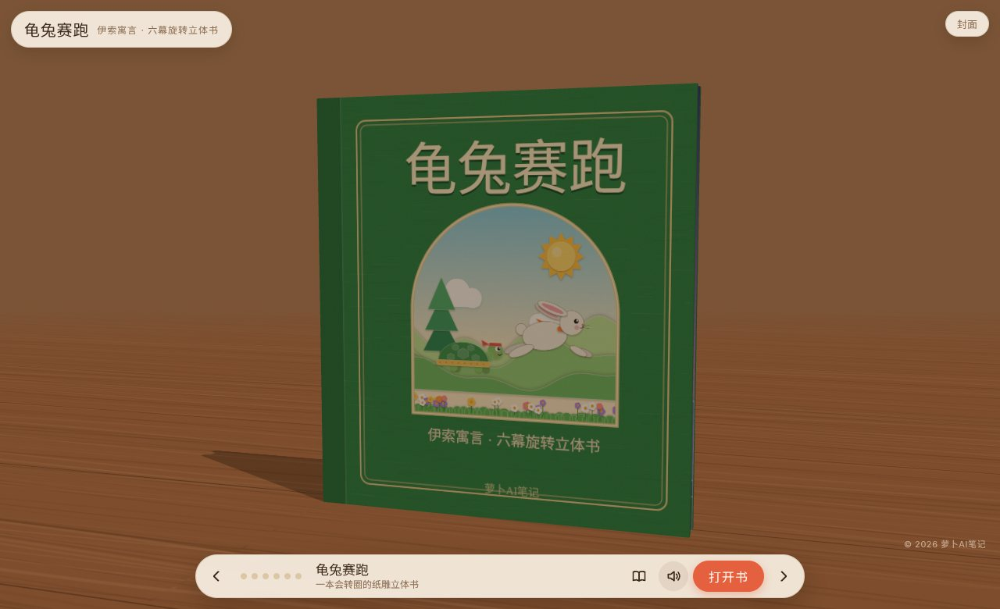
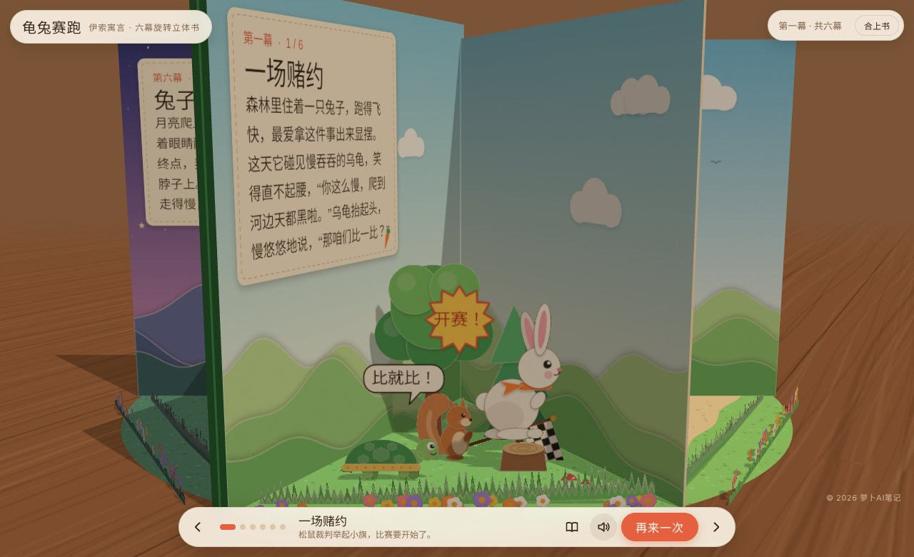
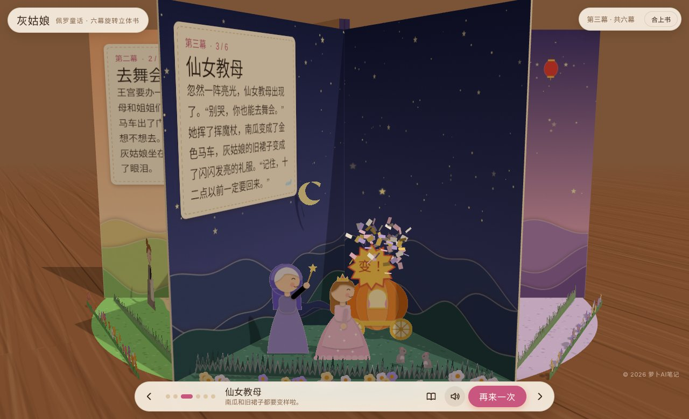
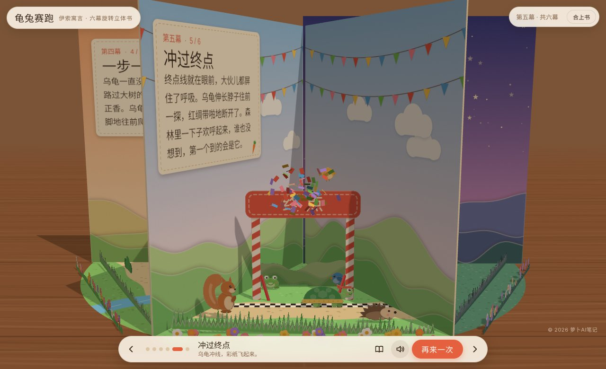
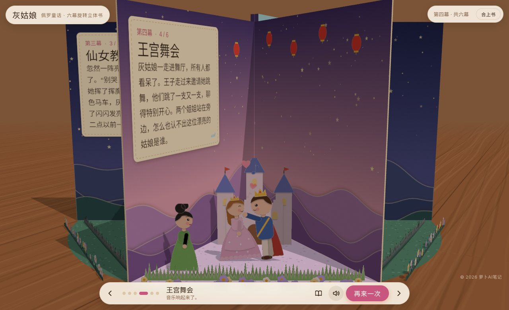

# popup-carousel-book 旋转纸雕立体书

给 Agent 一个故事主题，几分钟后得到一本能转圈翻看的 3D 纸雕立体书网页。

书立在木桌上自动翻开，书页围成一圈，四到八个楔形空间里各有一幕分层纸雕场景。左边书页印着这一幕的故事，点底栏的按钮，场景里的角色就会动起来。成品是单个 HTML 文件，双击就能打开。

> Turn any story into an interactive 3D paper-cut carousel pop-up book, as a single HTML file. Works as an Agent Skill in Claude, Claude Code, Codex and other agents that can read and write files.

| 龟兔赛跑 | 灰姑娘 |
|---|---|
|  |  |
|  |  |
|  |  |

## 能做什么

- **一句话出书**：说“做一本《乌鸦喝水》的立体书”，Agent 会自己编六幕故事、排布景、设计每一幕的动作，然后构建出网页。
- **每一幕都能互动**：走、跑、弹出、换姿势、挥魔杖、撒彩纸、扬尘、日落变色，动作都是预设好的，Agent 只需要填参数。
- **拖动转圈，能合上**：可以拖着书转圈看，也可以把书合上，看封面和封底。
- **阅读卡片**：书页上的字斜着不好读时，点一下就弹出大字卡片。
- **自带音效**：音效在浏览器里现场合成，有静音开关。
- **素材库**：大约四十种纸雕风格素材，包括兔、龟、猫、狐狸、狗、熊、老鼠、猪、羊、狼、熊猫、松鼠、小鸟、猫头鹰、青蛙、刺猬、Q 版人物、树、房子、拱桥、终点拱门、领奖台、灯笼等，还有十一套配色（清晨、正午、黄昏、夜晚、秋天、雪地、海边……）。
- **两种美术模式**：默认用代码绘制角色，任何环境都能跑。Agent 检测到可用的生图模型时，会自动给主角生图，再抠图嵌进页面，场景道具仍然用代码画，保证风格统一。
- **自动检查**：元素超出书页会自动缩小并给出警告，另附一个截图脚本，可以逐幕检查效果。

## 安装

这个仓库本身就是一个 skill 文件夹（根目录有 `SKILL.md`）。

- **Claude（网页版和桌面版）**：下载仓库 zip，在设置的 Skills 里上传。
- **Claude Code**：`git clone https://github.com/zhouwei713/popup-carousel-book ~/.claude/skills/popup-carousel-book`
- **其他 Agent**：把文件夹放进它读取 skill 的目录，或者直接让它先读 `SKILL.md`。

装好以后，对 Agent 说“用立体书 skill 做一本《小红帽》”就可以了。

## 不用 Agent，手动构建

```bash
# 1. 复制示例配置，改成你的故事
cp assets/example-tortoise-hare.js my-book.js

# 2. 构建（只需要 Python 3）
python3 scripts/build.py my-book.js my-book.html

# 3. 可选，截图检查（需要 Node 和 Playwright）
node scripts/check.mjs my-book.html shots/
```

在浏览器地址后面加 `#scene-3`，会直接跳到第三幕；加 `#scene-3-act`，会自动播放第三幕的动作。

## 目录

```
SKILL.md                   Agent 读的主说明：工作流程、布局规则、常见坑
assets/engine.html         立体书引擎（three.js），一般不需要改
assets/example-tortoise-hare.js  六幕完整示例，用到了几乎所有功能
references/config.md       配置项、配色、动作、楔形尺寸表
references/art.md          素材目录，以及自己画新角色的规范
references/image-mode.md   生图模式：提示词模板、抠图、嵌入
scripts/build.py           把配置和引擎拼成单个 HTML
scripts/cutout.py          生图素材抠图、裁剪、压缩
scripts/check.mjs          逐幕截图并输出布局警告
examples/                  成品示例：龟兔赛跑、灰姑娘（含自定义角色的写法）
```

## 一幕长什么样

```js
{
  title: '冲过终点', btn: '冲线', hint: '乌龟冲线，彩纸飞起来。', palette: 'festive',
  text: '终点线就在眼前，大伙儿都屏住了呼吸……',
  items: [
    { art: 'arch', args: { text: '终 点' }, d: 1.75, h: 1.55 },
    { id: 'ribL', art: 'ribbon', d: 1.78, x: -.55, y: .36, h: .07, ax: 0, ay: .5 },
    { id: 'ribR', art: 'ribbon', d: 1.78, x: .55, y: .36, h: .07, ax: 1, ay: .5 },
    { id: 'tort', art: 'tortoise', args: { band: true }, frames: [null, { f: 1 }], d: 2.05, x: -.62, h: .5 },
  ],
  action: [
    { t: 0, dur: 2, type: 'walk', target: 'tort', to: { x: .3 }, ease: 'out' },
    { t: .75, dur: .7, type: 'to', target: 'ribL', to: { rot: -1.3 }, ease: 'back' },
    { t: .75, dur: .7, type: 'to', target: 'ribR', to: { rot: 1.3 }, ease: 'back' },
    { t: .75, type: 'confetti', at: { d: 1.85, x: 0, y: .9 } },
  ],
}
```

`d` 是元素离书脊的距离（决定前后层次），`x` 是左右位置，`h` 是高度。完整说明见 [references/config.md](references/config.md)。

## 依赖

成品网页会从 jsDelivr 加载 three.js 0.160.0，从 Google Fonts 加载字体（默认站酷快乐体和站酷小薇体）。打不开 Google Fonts 时字体会退回系统字体，其他功能不受影响。

## 关于故事和角色

示例用的都是公版故事（伊索寓言、佩罗童话），人物造型全部原创。用这个 skill 做书时，请使用公版作品或原创故事，不要复刻受版权保护的角色形象。

## 致谢

灵感来自 [@techartist_](https://x.com/techartist_) 用 Claude 做的《The Owl and the Pussy-cat》旋转立体书。

## 许可证

[MIT](LICENSE) © 2026 萝卜AI笔记
